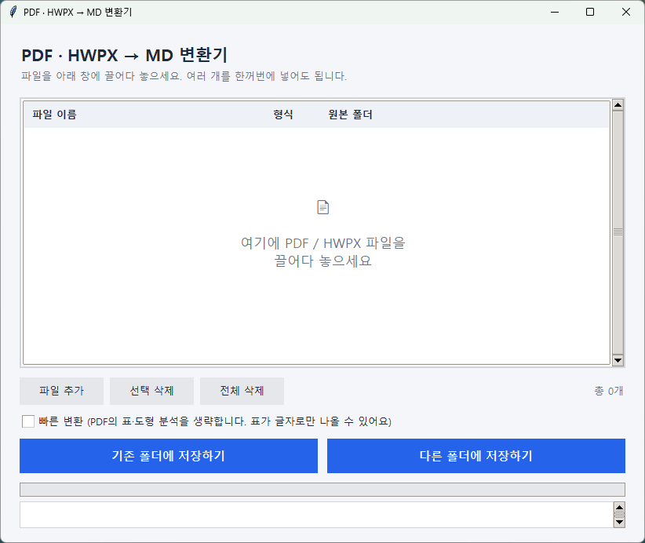

# 📝 PDF · HWPX → MD 변환기

### 👉 [📥 다운로드 및 실행 방법](docs/실행방법.md)

PDF와 한글(HWPX) 문서를 **마크다운(.md) 파일로 바꿔 주는** Windows용 프로그램입니다.
파일을 창 위로 끌어다 놓고 **저장 버튼**만 누르면 됩니다.

> 현재 버전: **1.0.2**

---

## 📖 간단 사용법

1. 프로그램을 실행하고 PDF 또는 HWPX 파일을 창 위로 끌어다 놓습니다. (여러 개, 폴더째로도 가능)
2. 저장 위치에 따라 버튼을 누릅니다.
   - **기존 폴더에 저장하기**: 원본 파일이 있는 폴더에 `.md`로 저장
   - **다른 폴더에 저장하기**: 폴더를 선택해서 그곳에 저장
3. 진행 창에서 쪽 단위 진행도를 확인합니다. 끝나면 완료 안내 창이 뜹니다.
4. 원본 파일은 바뀌지 않고, 항상 **새 `.md` 파일**로 저장됩니다.

### 자주 쓰는 팁
- **폴더째 추가하기**: 폴더를 끌어다 놓으면 그 안(하위 폴더 포함)의 PDF·HWPX 파일이 모두 추가됩니다.
- **목록에서 빼기**: 파일을 고르고 `Delete` 키 또는 **선택 삭제**, 전부 비우려면 **전체 삭제**를 누릅니다.
- **오래 걸릴 때**: 진행 창의 **취소** 버튼으로 중단할 수 있습니다. 이미 저장된 파일은 그대로 남습니다.
- **결과 확인**: 창 아래쪽 로그에 파일별 성공(✔)·실패(✘)와 저장 위치가 표시됩니다.

---

## ⚠️ 알아두실 점

- **옛 `.hwp` 파일은 변환할 수 없습니다.** 한글에서 `hwpx`로 다시 저장한 뒤 사용해 주세요. (목록에 추가할 때 자동으로 제외됩니다.)
- **스캔본·이미지로만 된 PDF**는 글자를 읽어 올 수 없어 실패할 수 있습니다. (글자 인식(OCR)은 지원하지 않습니다.)
- **배포용·암호가 걸린 HWPX**는 본문을 읽지 못할 수 있습니다.
- 같은 이름의 `.md` 파일이 이미 있으면 **덮어쓰지 않고** `파일명 (1).md`처럼 번호를 붙여 저장합니다.
- 일부 쪽이 복잡해서 일반 글자로만 변환된 경우, 결과 파일 맨 끝에 해당 쪽 번호가 주석(`<!-- ... -->`)으로 적힙니다.
- 프로그램을 켜면 새 버전이 있는지 확인해 안내합니다. 인터넷이 막혀 있으면 안내 없이 그대로 실행됩니다.
- 파일이 많거나 쪽 수가 많으면 시간이 다소 걸릴 수 있습니다. 변환 중에는 메인 창을 조작할 수 없습니다.

---

## ✨ 주요 기능

- **PDF**와 **HWPX**를 마크다운으로 변환
- 파일(또는 폴더)을 창 위로 **끌어다 놓기(드래그 앤 드롭)** 로 추가, **파일 추가** 버튼도 지원
- 파일 목록: 선택 삭제 / 전체 삭제 / `Delete` 키 삭제, 중복 파일 자동 제외
- **기존 폴더에 저장** / **다른 폴더에 저장** 선택
- HWPX의 **표를 마크다운 표로 변환**
- **진행 창**: 쪽 단위 진행도, 경과 시간, 남은 시간(예상), 취소 버튼
- **동시 변환**: 여러 파일은 물론 PDF 한 개도 나눠서 동시에 처리 (최대 4개, PC 사양에 맞춰 자동 조절)
- **새 버전 안내**: 업데이트가 있으면 알려 주고 다운로드 페이지를 열어 줌
- 같은 이름 파일은 번호를 붙여 저장해 **덮어쓰기 방지**

---

## 💻 사용 환경

- **Windows 10 / 11** (64비트)
- 한글이나 엑셀 등 **다른 프로그램은 필요 없습니다.**

---

## 📝 버전 이력

전체 버전 이력은 **[이력.md](docs/이력.md)** 에서 확인하실 수 있습니다.

---

## 🙋 문의 및 오류 제보

사용 중 불편한 점이나 오류가 있다면 [Issues](../../issues) 에 남겨 주세요.
오류 메시지 화면과 어떤 작업을 하던 중이었는지 함께 적어 주시면 큰 도움이 됩니다.

---

## 📜 라이선스

이 프로그램은 **GNU Affero General Public License v3.0 (AGPL-3.0)** 에 따라 배포됩니다.

- 소스코드는 이 저장소에서 누구나 볼 수 있습니다.
- 이 프로그램을 수정해서 배포하는 경우, 수정한 소스도 같은 AGPL-3.0 조건으로 공개해야 합니다.

### 사용한 오픈소스

| 라이브러리 | 라이선스 |
|---|---|
| [PyMuPDF](https://pymupdf.readthedocs.io/) / [PyMuPDF4LLM](https://pymupdf.readthedocs.io/en/latest/pymupdf4llm/) | AGPL-3.0 |
| [tkinterdnd2](https://github.com/Eliav2/tkinterdnd2) | MIT |
